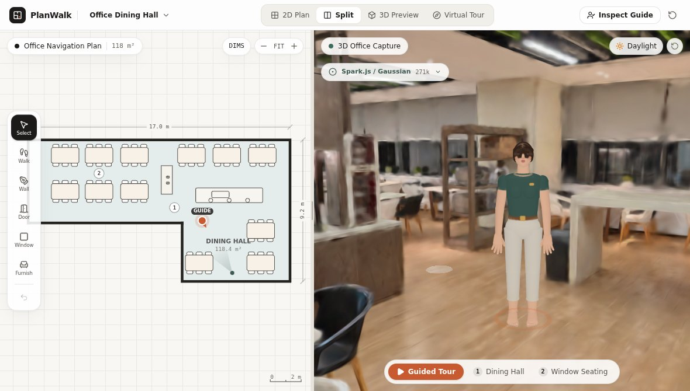
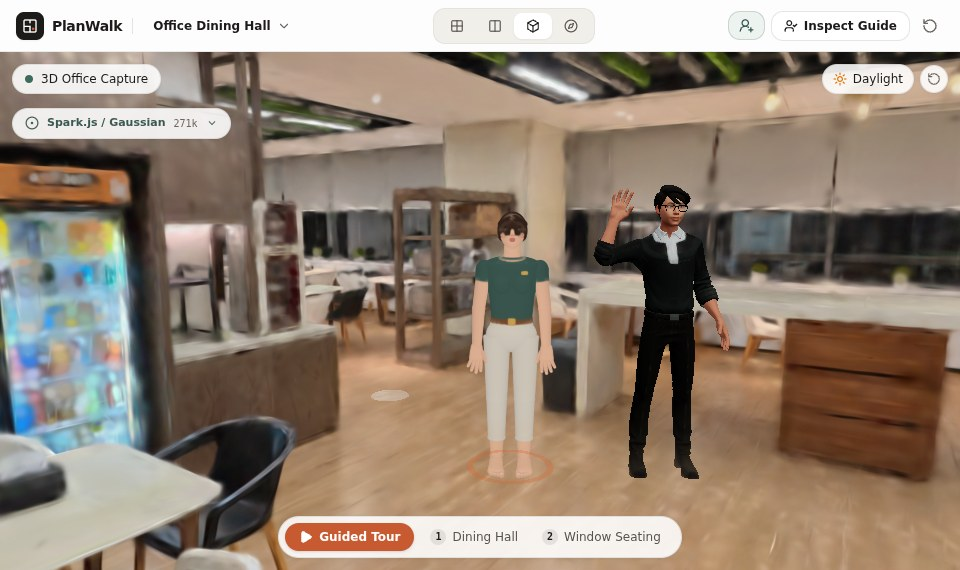

# Gaussian Office · PlanWalk Studio

Walk through an office dining hall with Elena, the articulated tour guide. The default 3D environment is the checked-in [`data/sog/office.sog`](data/sog/office.sog), rendered by Spark.js in Three.js. Elena is **not** part of the scan: her original model, joints, gestures, walking animation and close-up inspector are unchanged.



## Run locally

Use Node.js 22.12 or newer, npm, and a browser with WebGL2 and hardware acceleration. The repository includes the capture; no backend, API key or asset conversion is needed.

```sh
npm ci
npm run dev
```

Open the URL printed by Vite (usually `http://localhost:5173`). The app opens in **Office Dining Hall → Split**. On first load, **Loading office…** means the asset is being fetched, decoded and prepared for drawing. The navigation model stands in until the scan is ready.

## Explore and edit

- **3D Preview:** drag to orbit, scroll to zoom, or click the floor to walk Elena. Reset the camera to return to the interior starting view.
- **Virtual Tour:** follow Elena between the dining aisle and window seating. Drag to look around; use WASD or the arrow keys to walk. **Follow Elena** returns to the guided camera.
- **Inspect Guide:** switch between the full figure, head, hands and feet, or select a gesture.
- **2D Plan / Split:** the office plan is a hand-aligned approximation for picking, collision and routing. Editing a wall or moving a table changes that plan and its **Triangle mesh** preview; it does **not** move captured furniture or repaint the SOG.
- **Spark.js / Gaussian:** see the office and guide splat counts, choose Balanced or Fine detail, or switch to the triangle preview. Wall cutaways apply to the mesh preview, not the scan. The other floorplan presets still generate their own editable 3D architecture.

## Insert a human

1. Open **Insert human** in the header (the person-plus icon on small screens).
2. Choose **Studio library → Detailed visitor → Insert into scene**. This loads the dressed character from [`data/humans/man-2-unrig.glb`](data/humans/man-2-unrig.glb), in its rest pose. You can also pick this file or your own self-contained model (≤8 MiB) under **Local GLB**. No upload or motion JSON is required.
3. Look beside Elena: the new person stands on open floor, with a green marker on the plan. To stage someone in a different area, walk Elena there before inserting. Extras are ordinary or skinned meshes in **both** render modes; they do not replace the guide or change the scan.

**Animate the rigged visitor:** choose **Studio library → Rigged visitor → Insert into scene**, or select [`man-rig.glb`](data/humans/man-rig.glb) under **Local GLB**. The visitor raises his right hand, waves, then settles into a breathing idle next to Elena. For a moving shot, select the rigged visitor, open **Motion JSON → Use walk & greet take**, then insert. The [take](docs/prompts/man-rig.walk-and-greet.json) walks him down the aisle, turns him toward the opening camera, and plays the wave. Reopen **Insert human → Replay** to watch again.



The uploaded GLB has a skin but no embedded clips. PlanWalk authors `WelcomeWave`, `EasyIdle` and `HallwayWalk_IP` on its joints at import. To use those same actions in Blender or another glTF viewer, run `npm run export:rigged-visitor` after `npm ci`. It writes a self-contained `exports/man-rig-animated.glb` with all three clips and the original full-resolution materials; it never overwrites the upload.

**Animate Ada:** in the Office Dining Hall, choose **Studio library → Motion JSON → Use Ada’s sample take → Insert into scene**. The sample selects **Animated visitor** (`Visitor.glb`): Ada walks from the aisle to the window seating, turns, then waves. The detailed model has a skeleton but **no embedded idle, walk or wave clips**. To use your own blocking, paste a `planwalk.humans.v1` take or choose **Open JSON**; select the GLBs named in it, matching case. The [authoring guide, schema and two-person example](docs/prompts/human-motion-v1.md) describe the format. For the two-model example use **Local GLB** and select both [`Visitor.glb`](data/humans/Visitor.glb) and your own `Host.glb`.

Reopen the menu to **pause, replay or remove** extras. Insertion is additive, up to **two people besides Elena**. Resetting, switching presets or reloading clears the extras. A rejected import leaves the existing people in place. Check the [model handoff limits](RENDERING.md#additional-human-models) before exporting a GLB.

## Build and verify

```sh
npx tsc --noEmit
npm run build
npm run preview
```

Serve the **whole `dist/` directory over HTTP(S)**. Vite inlines the application code but emits the office `.sog` and all three library `.glb` files as separate, hashed assets beside `index.html`. The viewer fetches a visitor only when inserted. Deploying just the HTML omits these assets. If **Triangle preview · Fallback** appears, open rendering settings for the error and check that the `.sog` request returns the binary, not a 404 or an HTML page.

To run the browser checks:

```sh
npx playwright install chromium
npx playwright test
```

See [Rendering and asset budgets](RENDERING.md) for the coordinate transform, LOD targets and in-engine acceptance checks.

## Capture credit

**[天安骏业集团餐厅](https://superspl.at/scene/40c67340)** by [Hilo](https://superspl.at/user/heroizme), licensed under [CC BY 4.0](https://creativecommons.org/licenses/by/4.0/). The original attribution is in `license.txt` inside `office.sog`. The archive is unchanged; the viewer rotates and offsets the capture, builds runtime LODs and renders Elena separately. The screenshot above shows that composite.
